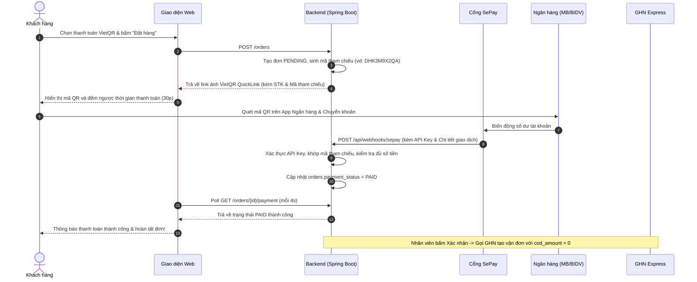

# 🛒 ElectronicsStore (UTE Shop) — Nền tảng Thương mại Điện tử Đa kênh

<div align="center">


<br/>

**Trang Web Demo Trực Tuyến**:  
### 🌐 [https://electronicstore-19nw.onrender.com](https://electronicstore-19nw.onrender.com)

**Kho lưu trữ GitHub**:  
🔗 [https://github.com/thongledai/ElectronicsStore](https://github.com/thongledai/ElectronicsStore)

</div>

---

## 📌 1. Giới thiệu tổng quan

**ElectronicsStore (UTE Shop)** là nền tảng thương mại điện tử chuyên kinh doanh các thiết bị công nghệ (Laptop, Điện thoại thông minh, Tai nghe, Đồng hồ thông minh và Phụ kiện). Dự án được thiết kế và xây dựng theo mô hình kiến trúc Client-Server hiện đại trên nền tảng **Java 22** và **Spring Boot**, đáp ứng đầy đủ các tiêu chuẩn nghiệp vụ e-commerce thực tế:

* **Trải nghiệm khách hàng mượt mà**: Giao diện Responsive hiện đại (Bootstrap 5), tìm kiếm & lọc sản phẩm tức thì, giỏ hàng lưu trữ Database, danh sách yêu thích, đánh giá sao kèm nhận xét, và live chat hỗ trợ thời gian thực (WebSocket).
* **Thanh toán tự động 4.0**: Hỗ trợ COD, chuyển khoản ngân hàng **VietQR** đối soát tự động qua **SePay Webhook**, và hệ thống **Ví điện tử (E-Wallet)** nạp rút an toàn với cơ chế khóa bi quan (*Pessimistic Lock*).
* **Logistics chuyên nghiệp**: Tích hợp trực tiếp API **Giao Hàng Nhanh (GHN Express)** để đồng bộ danh mục địa giới hành chính, tính toán phí vận chuyển tự động và sinh mã vận đơn giao hàng.
* **Bảo mật & Phân quyền chặt chẽ**: Kiến trúc Stateless JWT lưu trong **HttpOnly Cookie** chống tấn công XSS/CSRF, đăng nhập Google OAuth2, xác thực OTP qua Brevo Email REST API, cùng phân quyền đa tầng (**RBAC**: Customer, Employee, Manager, Shipper, Admin).

---

## 🌟 2. Tính năng nổi bật & Bảng nghiệp vụ chi tiết

### 🛍️ 2.1. Phân hệ Khách hàng (Customer Experience)
- **Catalog & Tìm kiếm thông minh**:
  - Tìm kiếm toàn văn theo từ khóa, gợi ý sản phẩm.
  - Bộ lọc đa chiều: Theo danh mục, thương hiệu, khoảng giá linh hoạt (min - max), trạng thái còn hàng/hết hàng, sản phẩm đang khuyến mãi, và điểm đánh giá tối thiểu.
  - Sắp xếp đa dạng: Mới nhất, giá tăng dần/giảm dần, bán chạy, phổ biến, mức chiết khấu cao.
- **Giỏ hàng & Đặt hàng (Cart & Checkout)**:
  - Giỏ hàng lưu trữ database (không bị mất khi đổi thiết bị hoặc đăng xuất).
  - Tự động kiểm tra số lượng tồn kho khả dụng khi thêm hoặc thay đổi số lượng.
  - Chọn địa chỉ giao hàng với dữ liệu Tỉnh/Thành, Phường/Xã lấy trực tiếp từ GHN API.
  - Tự động tính phí ship và dự kiến ngày giao hàng.
  - Áp dụng mã giảm giá (Voucher) theo % hoặc tiền cố định.
- **Thanh toán linh hoạt**:
  - **COD**: Thanh toán tiền mặt khi nhận hàng.
  - **VietQR (SePay)**: Quét mã QR ngân hàng tạo động, hệ thống tự động nhận webhook và chuyển trạng thái `PAID` tức thì.
  - **Ví điện tử UTE Wallet**: Nạp tiền qua VietQR, thanh toán đơn hàng trực tiếp bằng số dư ví trong 1 cú click.
- **Tương tác & Cá nhân hóa**:
  - **Danh sách yêu thích (Wishlist)**: Lưu lại các sản phẩm quan tâm.
  - **Đánh giá & Bình luận (Reviews)**: Đánh giá 1-5 sao và viết nhận xét cho đơn hàng đã mua.
  - **Hồ sơ cá nhân (Profile)**: Cập nhật thông tin, địa chỉ mặc định, tải lên avatar lưu trữ trên **Cloudinary**, đổi mật khẩu.
  - **Hỗ trợ trực tuyến (Customer Chat)**: Khung chat thời gian thực qua Spring WebSocket.

### 💼 2.2. Phân hệ Quản trị & Nhân viên (Admin & Operations)
- **Quản lý Catalog (Manager)**:
  - CRUD Sản phẩm, Biến thể (Ram, Ổ cứng, Màu sắc), Thuộc tính kiểu dáng (Styles/Values).
  - Quản lý Danh mục (Categories) theo cấp bậc cha - con, Thương hiệu (Brands).
  - Upload hình ảnh sản phẩm trực tiếp lên dịch vụ đám mây Cloudinary.
  - Hỗ trợ xóa mềm (Soft delete) và khôi phục (Restore).
- **Quản lý Khuyến mãi & Vouchers (Employee / Manager)**:
  - Tạo và phát hành mã giảm giá theo tỷ lệ `%` hoặc số tiền cố định.
  - Thiết lập giá trị đơn hàng tối thiểu, mức giảm tối đa, giới hạn số lượt dùng và khoảng thời gian hiệu lực.
  - Bật/tắt trạng thái voucher nhanh chóng.
- **Quản lý Đơn hàng & Vận chuyển (Employee / Manager)**:
  - Bảng điều khiển đơn hàng phân loại theo tab trạng thái (`Chờ xác nhận`, `Đã xác nhận`, `Đang giao`, `Đã giao`, `Đã hủy`, `Hoàn hàng`).
  - Kiểm tra điều kiện đơn trả trước (`PAID`) trước khi cho phép xác nhận.
  - 1-Click tạo mã vận đơn qua GHN Express; tự động truyền `cod_amount = 0` cho đơn đã thanh toán.

---

## 💳 3. Luồng Xử lý Thanh toán VietQR & SePay Webhook



---

## 🛠️ 4. Kiến trúc & Công nghệ Sử dụng (Tech Stack)

| Phân tầng | Công nghệ | Chi tiết sử dụng |
|---|---|---|
| **Core & Language** | **Java 22** | Sử dụng các tính năng mới nhất của Java 22, Records, Pattern Matching. |
| **Framework** | **Spring Boot 4.1.1** | Spring Web MVC, Spring Data JPA, Spring Security 6, Spring Validation, Spring Mail, WebSocket. |
| **Bảo mật & Token** | **Nimbus-JOSE-JWT** | Tạo, ký và xác thực JSON Web Token không trạng thái. |
| **Cơ sở dữ liệu** | **MySQL 8.0** | Lưu trữ quan hệ, transaction ACID, chỉ mục tối ưu tìm kiếm, hỗ trợ H2 Database cho Unit Test. |
| **Giao diện (Frontend)** | **Thymeleaf + Bootstrap 5.3** | Template engine phía server kết hợp Bootstrap 5, Font Awesome 6 và JavaScript Fetch API. |
| **Quản lý Media** | **Cloudinary SDK** | Upload, tối ưu hóa và lưu trữ hình ảnh sản phẩm/avatar trên Cloud. |
| **Email Service** | **Brevo REST API v3** | Gửi email thông báo và mã OTP kích hoạt tài khoản/quên mật khẩu. |
| **Cổng thanh toán** | **VietQR + SePay** | Sinh mã QR động chuẩn Napas 247 và Webhook tự động đối soát tiền vào. |
| **Giao vận (Logistics)** | **GHN Express API** | Tích hợp dịch vụ chuyển phát nhanh Giao Hàng Nhanh. |
| **DevOps & Cloud** | **Docker & Render** | Đóng gói Multi-stage Dockerfile, triển khai tự động trên PaaS Render và Aiven Cloud DB. |

---

## 📂 5. Cấu trúc thư mục dự án

```text
ElectronicsStore/
├── .env                              # Cấu hình biến môi trường cục bộ (không commit secret)
├── Dockerfile                        # Multi-stage Dockerfile tối ưu cho Java 22
├── docker-compose.yml                # File khởi chạy container tổng thể
├── database.sql                      # Kịch bản khởi tạo Schema & Seed dữ liệu ban đầu
├── pom.xml                           # File quản trị thư viện Maven
├── docs/                             # Thư mục tài liệu kỹ thuật chi tiết
│   ├── README.md                     # Mục lục hệ thống tài liệu
│   ├── auth-security.md              # Tài liệu xác thực, JWT, RBAC & OTP
│   ├── online_payment.md             # Tài liệu thanh toán VietQR & SePay Webhook
│   ├── e_wallet.md                   # Tài liệu ví điện tử UTE Wallet
│   ├── ghn-delivery.md               # Tài liệu tích hợp vận chuyển GHN Express
│   ├── order-management.md           # Tài liệu quy trình & vòng đời đơn hàng
│   ├── vouchers-promotions.md        # Tài liệu quản trị & áp dụng Voucher
│   ├── product-search-filter.md      # Tài liệu cơ chế tìm kiếm & bộ lọc sản phẩm
│   ├── customer-features.md          # Tài liệu Giỏ hàng, Wishlist, Đánh giá, Chat
│   ├── manager-crud.md               # Tài liệu CRUD Quản trị Catalog
│   ├── bootstrap-template.md         # Tài liệu giao diện Bootstrap
│   └── deployment-guide.md           # Hướng dẫn chi tiết triển khai lên Cloud (Render)
└── src/
    ├── main/
    │   ├── java/com/example/store/
    │   │   ├── config/               # Cấu hình Spring Security, Cloudinary, MVC, WebSocket
    │   │   ├── controller/           # REST API & Web MVC Controllers (Customer, Employee, Manager)
    │   │   ├── dto/                  # Data Transfer Objects & Validation Requests
    │   │   ├── entity/               # Hibernate/JPA Entities
    │   │   ├── enums/                # Kiểu liệt kê (OrderStatus, PaymentStatus, Roles...)
    │   │   ├── filter/               # JwtAuthenticationFilter
    │   │   ├── mapper/               # MapStruct Mappers & GHN Payload Mappers
    │   │   ├── repository/           # Spring Data JPA Repositories
    │   │   ├── security/             # CustomUserDetails & Token Provider
    │   │   └── service/              # Logic nghiệp vụ (Auth, Product, Order, Payment, GHN...)
    │   └── resources/
    │       ├── application.properties# File cấu hình trung tâm Spring Boot
    │       ├── static/               # CSS, JavaScript (Fetch API), Hình ảnh SVG/PNG
    │       └── templates/            # Giao diện Thymeleaf HTML (Customer, Employee, Manager)
    └── test/                         # Unit tests & Integration tests
```

---

## 🚀 6. Hướng dẫn Cài đặt & Khởi chạy (Getting Started)

### 6.1. Yêu cầu môi trường
* **Java**: JDK 22 trở lên.
* **Maven**: 3.9 trở lên (hoặc sử dụng sẵn Maven Wrapper `mvnw` đi kèm).
* **Cơ sở dữ liệu**: MySQL Server 8.0+.

### 6.2. Cài đặt Cơ sở dữ liệu
1. Mở MySQL Workbench hoặc CLI:
   ```sql
   CREATE DATABASE Store_Electronic CHARACTER SET utf8mb4 COLLATE utf8mb4_unicode_ci;
   ```
2. Import schema và dữ liệu mẫu từ file [`database.sql`](file:///d:/JAVA/ElectronicsStore/database.sql):
   ```powershell
   mysql -u root -p Store_Electronic < database.sql
   ```

### 6.3. Cấu hình biến môi trường (`.env`)
Tạo file `.env` tại thư mục gốc của dự án (tham khảo cấu trúc):
```env
# Database Configuration
DB_URL=jdbc:mysql://localhost:3306/Store_Electronic?useSSL=false&allowPublicKeyRetrieval=true&serverTimezone=UTC
DB_USERNAME=root
DB_PASSWORD=your_mysql_password
DDL_AUTO=update
SHOW_SQL=true
SERVER_PORT=8080

# Email OTP Service (Brevo API)
BREVO_API_KEY=your_brevo_api_key
BREVO_SENDER_EMAIL=no-reply@technova.com
BREVO_SENDER_NAME=TechNova Store

# Cloudinary Media Storage
CLOUDINARY_CLOUD_NAME=your_cloud_name
CLOUDINARY_API_KEY=your_cloudinary_api_key
CLOUDINARY_API_SECRET=your_cloudinary_api_secret

# Google OAuth2 (Tùy chọn)
GOOGLE_CLIENT_ID=your_google_client_id.apps.googleusercontent.com

# Giao Hàng Nhanh (GHN) Dev Gateway
GHN_BASE_URL=https://dev-online-gateway.ghn.vn
GHN_TOKEN=your_ghn_token
GHN_SHOP_ID=your_shop_id
GHN_SHOP_DISTRICT_ID=3695
GHN_SHOP_WARD_ID=90742

# Thanh toán VietQR & SePay Webhook
PAYMENT_BANK_BIN=970418
PAYMENT_BANK_NAME=BIDV
PAYMENT_ACCOUNT_NUMBER=96247SVOF9
PAYMENT_ACCOUNT_NAME=LE DAI THONG
PAYMENT_REFERENCE_PREFIX=DH
SEPAY_API_KEY=your_sepay_api_key
```

### 6.4. Khởi chạy ứng dụng

**Cách 1: Sử dụng Maven Wrapper**
```powershell
# Chạy trực tiếp
.\mvnw.cmd spring-boot:run

# Hoặc đóng gói file JAR
.\mvnw.cmd clean package -DskipTests
java -jar target/store-0.0.1-SNAPSHOT.jar
```

**Cách 2: Sử dụng Docker Compose**
```powershell
docker compose up -d --build
```

Sau khi khởi chạy thành công, truy cập trình duyệt tại địa chỉ: **`http://localhost:8080`**.

---

## 👥 7. Tài khoản Trải nghiệm & Ma trận Phân quyền

Hệ thống có sẵn các tài khoản demo tương ứng với từng vai trò trong dữ liệu mẫu:

| Tài khoản (Email) | Mật khẩu mặc định | Vai trò (Role) | Trang giao diện chính |
|---|---|---|---|
| `admin@technova.com` | `Admin@123` | **ADMIN** | Toàn quyền cấu hình `/manager/**` |
| `manager@technova.com` | `Manager@123` | **MANAGER** | Quản trị Catalog & Sản phẩm `/manager/products` |
| `employee@technova.com` | `Employee@123` | **EMPLOYEE** | Xử lý Đơn hàng & Vận đơn GHN `/employee/orders` |
| `shipper@technova.com` | `Shipper@123` | **SHIPPER** | Bảng điều phối giao nhận `/shipper/**` |
| `customer@technova.com` | `Customer@123` | **CUSTOMER** | Mua sắm, ví điện tử, đơn hàng `/customer/index` |

---

## 📚 8. Tài liệu kỹ thuật chuyên sâu

Chi tiết về cấu hình endpoint, request/response, mô hình dữ liệu và hướng dẫn vận hành cho từng module được lưu trữ tại thư mục [docs/](./docs/README.md):

* 📘 [Tài liệu Xác thực, JWT & Phân quyền RBAC](./docs/auth-security.md)
* 💳 [Tài liệu Tích hợp VietQR & SePay Webhook](./docs/online_payment.md)
* 🪙 [Tài liệu Hệ thống Ví điện tử UTE Wallet](./docs/e_wallet.md)
* 🚚 [Tài liệu Giao vận GHN Express & Đồng bộ Địa chỉ](./docs/ghn-delivery.md)
* 📦 [Tài liệu Quy trình & Vòng đời Đơn hàng](./docs/order-management.md)
* 🎟️ [Tài liệu Quản lý & Áp dụng Voucher Khuyến mãi](./docs/vouchers-promotions.md)
* 🔍 [Tài liệu Cơ chế Tìm kiếm & Bộ lọc Sản phẩm](./docs/product-search-filter.md)
* 👤 [Tài liệu Phân hệ Khách hàng (Cart, Wishlist, Reviews, Chat)](./docs/customer-features.md)
* 🛠️ [Tài liệu CRUD Quản trị Catalog & Sản phẩm](./docs/manager-crud.md)
* 🎨 [Tài liệu Thiết kế Giao diện Bootstrap 5](./docs/bootstrap-template.md)
* ☁️ [Hướng dẫn Triển khai Cloud (Docker / Render / Aiven)](./docs/deployment-guide.md)

---

## 📄 9. Bản quyền & Thông tin Dự án

Dự án được xây dựng và phát triển phục vụ mục đích học tập, nghiên cứu và làm đồ án tốt nghiệp chuyên ngành Công nghệ Thông tin. Mọi đóng góp hoặc thắc mắc vui lòng liên hệ qua email hoặc tạo Issue trên kho lưu trữ GitHub!
