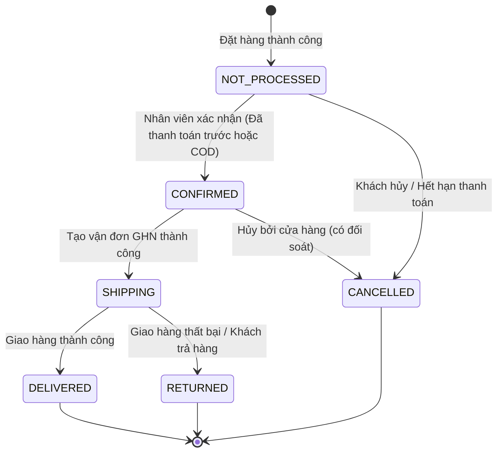

# Quản lý Đơn hàng & Vòng đời Đơn (Order Lifecycle)

## 1. Tổng quan

Module Đơn hàng xử lý toàn bộ quy trình mua sắm từ lúc khách hàng tạo giỏ hàng, thực hiện thanh toán (Checkout) cho đến khi đơn hàng được nhân viên xử lý, đóng gói, tạo vận đơn GHN và bàn giao cho khách hàng.

---

## 2. Vòng đời Trạng thái Đơn hàng (Order State Machine)

Một đơn hàng trong hệ thống trải qua các trạng thái sau:

### Chi tiết các trạng thái đơn hàng (`OrderStatus`):
- `NOT_PROCESSED` (Chờ xác nhận): Đơn hàng mới tạo. Nếu chọn chuyển khoản VietQR, đơn sẽ giữ tồn kho trong 30 phút chờ thanh toán.
- `CONFIRMED` (Đã xác nhận): Đơn COD hợp lệ hoặc đơn chuyển khoản/ví đã thanh toán (`PAID`), được nhân viên kiểm tra và xác nhận đóng gói.
- `SHIPPING` (Đang giao hàng): Đơn hàng đã được tạo mã vận đơn với Giao Hàng Nhanh (GHN) và bàn giao cho bưu tá.
- `DELIVERED` (Đã giao hàng): Khách hàng đã nhận kiện hàng thành công.
- `CANCELLED` (Đã hủy): Đơn hàng bị hủy do khách hàng, do quá hạn thanh toán 30 phút, hoặc do hết hàng. Tồn kho sản phẩm được hoàn lại tự động.
- `RETURNED` (Đã hoàn hàng): Khách hàng trả hàng hoặc bưu tá hoàn hàng về kho.

---

## 3. Trạng thái Thanh toán (`PaymentStatus`)

- `UNPAID`: Chưa thanh toán (mặc định với đơn QR VietQR hoặc COD chưa nhận hàng).
- `PAID`: Đã thanh toán thành công (xác nhận qua webhook SePay, trừ số dư Ví điện tử, hoặc thu tiền COD thành công).
- `EXPIRED`: Hết hạn thanh toán (áp dụng cho đơn VietQR sau 30 phút không nhận được tiền).
- `REFUNDED`: Đã hoàn tiền cho khách hàng.
- `NEEDS_RECONCILIATION`: Cần đối soát thủ công (chuyển sai số tiền, tiền đến sau khi đơn hết hạn).

---

## 4. Quy trình Đặt hàng phía Khách hàng (Checkout Flow)

1. **Chuẩn bị đơn hàng**:
   - Khách hàng chọn sản phẩm vào Giỏ hàng (`/cart`).
   - Nhấn "Thanh toán" chuyển đến màn hình `/customer/checkout`.
2. **Cung cấp địa chỉ & Tính phí ship**:
   - Chọn Tỉnh/Thành phố và Phường/Xã (dữ liệu đồng bộ trực tiếp từ GHN Address API).
   - Hệ thống tự động tính toán phí vận chuyển và ngày dự kiến nhận hàng (`eta`).
3. **Áp dụng Mã giảm giá (Voucher)**:
   - Nhập mã voucher và kiểm tra điều kiện áp dụng. Số tiền giảm được trừ trực tiếp vào tổng thanh toán.
4. **Lựa chọn phương thức thanh toán**:
   - **COD (Thanh toán khi nhận hàng)**: Đơn tạo ngay ở trạng thái `NOT_PROCESSED`, `paymentStatus = UNPAID`.
   - **Chuyển khoản QR (VietQR qua SePay)**: Đơn tạo kèm mã tham chiếu và hiển thị mã QR động để quét trên App ngân hàng.
   - **Ví điện tử (E-Wallet)**: Khóa dòng user (Pessimistic Lock) và trừ tiền ngay trong transaction.
5. **Theo dõi đơn hàng**:
   - Khách hàng truy cập `/customer/orders` để xem danh sách đơn hàng đã mua, trạng thái xử lý và mã vận đơn tracking.

---

## 5. Quản lý Đơn hàng phía Nhân viên (Employee / Manager)

Nhân viên truy cập giao diện `/employee/orders` để thực hiện:
- **Lọc đơn theo trạng thái**: Các tab trạng thái rõ ràng (Chờ xác nhận, Đã xác nhận, Đang giao, Đã giao, Đã hủy, Hoàn hàng).
- **Tìm kiếm đơn**: Tìm theo tên khách hàng, số điện thoại, hoặc mã vận đơn GHN.
- **Xác nhận đơn hàng**:
  - Đối với đơn COD: Nhân viên xác nhận thông tin đơn hàng.
  - Đối với đơn Trả trước (VietQR / E-Wallet): Backend ràng buộc đơn phải có `paymentStatus = PAID` mới cho phép xác nhận.
- **Tạo vận đơn GHN**:
  - Tự động chuyển thông tin kiện hàng (kích thước, cân nặng, địa chỉ người nhận) sang GHN API.
  - Lưu mã vận đơn `ghnOrderCode` vào hệ thống và chuyển trạng thái đơn sang `SHIPPING`.
  - Đối với đơn đã trả trước, hệ thống truyền `cod_amount = 0` sang GHN để tránh thu tiền 2 lần.

---

## 6. Danh sách Endpoint Quản lý Đơn hàng

| Method | Endpoint | Quyền | Mục đích |
|---|---|---|---|
| `POST` | `/orders` | CUSTOMER | Tạo đơn hàng mới từ giỏ hàng hoặc mua ngay |
| `GET` | `/customer/orders` | CUSTOMER | Xem trang danh sách đơn hàng của tôi |
| `GET` | `/orders/{id}/payment` | CUSTOMER (Chủ đơn) | Lấy thông tin thanh toán & mã QR của đơn |
| `POST` | `/orders/{id}/cancel` | CUSTOMER / EMPLOYEE | Yêu cầu hủy đơn hàng (hoàn tồn kho) |
| `GET` | `/employee/orders` | EMPLOYEE, MANAGER | Xem giao diện quản lý toàn bộ đơn hàng |
| `POST` | `/api/employee/orders/{orderId}/confirm` | EMPLOYEE, MANAGER | Xác nhận đơn hàng |
| `POST` | `/api/employee/orders/{orderId}/ghn-shipment` | EMPLOYEE, MANAGER | Gọi API GHN tạo vận đơn giao hàng |
| `GET` | `/api/employee/orders/{orderId}/ghn-shipment` | EMPLOYEE, MANAGER | Xem chi tiết thông tin vận đơn GHN đã tạo |

---

## 7. Mã nguồn liên quan

- Giao diện đặt hàng: `src/main/resources/templates/customer/checkout.html`
- Giao diện đơn hàng khách: `src/main/resources/templates/customer/orders.html`
- Giao diện quản lý đơn nhân viên: `src/main/resources/templates/employee/orders.html`
- Controller đặt hàng: `src/main/java/com/example/store/controller/web/customer/OrderCustomerController.java` (hoặc tương đương)
- Controller vận đơn GHN: `src/main/java/com/example/store/controller/api/employee/OrderShipmentEmployeeControllerAPI.java`
- Service nghiệp vụ đơn: `src/main/java/com/example/store/service/order/impl/OrderServiceImpl.java`
- Service tích hợp GHN: `src/main/java/com/example/store/service/delivery/impl/GhnDeliveryServiceImpl.java`
